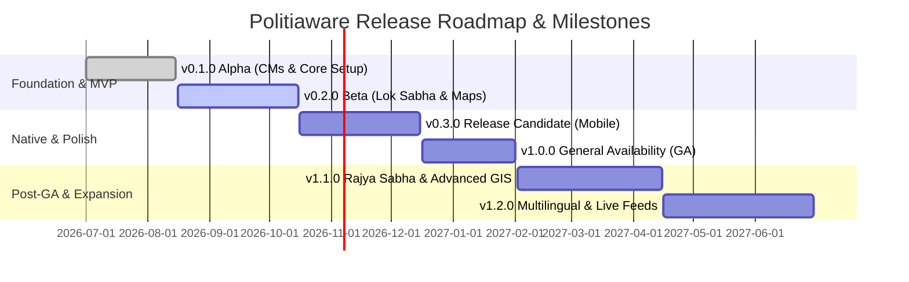

# Politiaware (Adhikar) - Release Plan

This document outlines the release engineering lifecycle, versioning strategy, milestone schedule, testing gates, build and packaging workflows, and deployment procedures for the **Politiaware (Adhikar) Frontend** application (Ionic React + TypeScript + Capacitor).

---

## 📌 1. Release Strategy & Versioning

### 1.1 Semantic Versioning (SemVer 2.0.0)
The application adheres strictly to [Semantic Versioning](https://semver.org/):
$$\text{MAJOR}.\text{MINOR}.\text{PATCH}$$

- **MAJOR (`X.0.0`)**: Incompatible architectural overhauls, major UI/UX re-designs, breaking backend GraphQL schema migrations, or fundamental framework transitions (e.g., React/Ionic major version upgrades).
- **MINOR (`0.Y.0`)**: Backward-compatible new feature additions (e.g., new Lok Sabha portal, Rajya Sabha analytics, interactive constituency map, export features).
- **PATCH (`0.0.Z`)**: Backward-compatible bug fixes, UI styling patches, security patches, dependency updates, and minor performance optimizations.
- **Pre-release Tags**: `-alpha.x`, `-beta.x`, `-rc.x` (e.g., `v0.2.0-rc.1`).

### 1.2 Git Branching & Workflow Model

```text
  main (Production / Stable Releases)
   ▲
   │ [Release PR / Tag v1.0.0]
 release/v1.0.0
   ▲
   │ [Feature Freeze & Hardening]
 develop (Integration Branch)
   ▲
   ├── feature/lok-sabha-filters
   ├── feature/leaflet-choropleth-maps
   └── bugfix/table-pagination-sort
```

| Branch | Purpose | Protection Rules |
| :--- | :--- | :--- |
| `main` | Production-ready code. Every commit is tagged with a release version (e.g. `v1.0.0`). | Requires PR, 2 approvals, passing CI tests, linear history. |
| `release/vX.Y.Z` | Release candidate staging branch for QA, final testing, and version bump. | Cut from `develop`, only bug fixes allowed, merged into `main` and `develop`. |
| `develop` | Active integration branch for upcoming releases. | Requires PR, automated lint & unit test passes. |
| `feature/*` | Feature development branches. | Branched from `develop`, merged back to `develop` via PR. |
| `hotfix/*` | Critical production hotfixes. | Branched from `main`, merged into `main` and `develop`. |

---

## 🗓 2. Release Milestones & Target Schedule



### Milestone Breakdown

| Milestone | Target Window | Status | Key Deliverables & Scope |
| :--- | :--- | :--- | :--- |
| **v0.1.0-alpha** | Q3 2026 | **Completed** | • Core Ionic 9 + React 19 architecture setup.<br>• Chief Ministers (CMs) page with Table and Chart views.<br>• Dynamic GraphQL query service with runtime `config.json`.<br>• Responsive desktop/mobile side drawer. |
| **v0.2.0-beta** | Q3–Q4 2026 | **In Progress** | • Lok Sabha MP portal with comprehensive filters (`TableHead`).<br>• Leaflet GIS map with India state boundaries and demographic popups.<br>• Custom category toggle switch (`Selectable`) component.<br>• Cypress E2E test suite integration. |
| **v0.3.0-rc** | Q4 2026 | **Planned** | • Capacitor 7 native Android (`.apk`/`.aab`) and iOS (`.ipa`) builds.<br>• Offline data caching (Apollo Client cache + IndexedDB).<br>• Push notifications, haptic feedback, and status bar styling.<br>• Dark / Light dynamic theme optimization. |
| **v1.0.0 (GA)** | Q1 2027 | **Planned** | • Production launch for Web, Android Play Store, and iOS App Store.<br>• Complete civic dataset (CMs, Lok Sabha, State Governors).<br>• Sentry performance & error telemetry.<br>• Automated CI/CD build & release pipeline. |
| **v1.1.0** | Q2 2027 | **Future** | • Rajya Sabha member directory & analytics.<br>• District and constituency-level vector maps.<br>• PDF & CSV data export capabilities. |
| **v1.2.0** | Q3 2027 | **Future** | • Multilingual localization (Hindi, Telugu, Tamil, Marathi, Bengali, etc.).<br>• Live election results integration and alerts. |

---

## 📋 3. Release Checklist & Quality Gates

Each release candidate (`release/*`) must pass all defined gates before promotion to `main` and production distribution.

### 3.1 Pre-Release Phase (Feature Freeze & Verification)
- [ ] **Code Freeze**: No new feature PRs merged into the release branch.
- [ ] **Dependency Audit**: Verify `npm audit` for zero high/critical vulnerabilities.
- [ ] **TypeScript Check**: Zero compiler errors (`tsc --noEmit`).
- [ ] **Static Code Analysis**: Pass ESLint rules without warnings (`npm run lint`).
- [ ] **Unit Tests**: Pass all Vitest suites with minimum 80% coverage (`npm run test.unit`).
- [ ] **End-to-End Tests**: Pass all Cypress flows (`npm run test.e2e`).
- [ ] **GraphQL Schema Sync**: Verify frontend GraphQL queries match backend Django schema definitions.
- [ ] **Mobile Asset Audit**: Verify app icons, splash screens, and asset permissions for iOS/Android.

### 3.2 Build & Packaging Phase
- [ ] **Version Bump**: Update `version` in `package.json` and sync mobile build codes.
- [ ] **Changelog Update**: Document additions, improvements, and fixes in `CHANGELOG.md`.
- [ ] **Production Web Build**: Run `npm run build` and test output with `npm run preview`.
- [ ] **Capacitor Sync**: Run `npx cap sync` to synchronize web assets with native mobile projects.
- [ ] **Android Build**: Generate signed Release Android App Bundle (`.aab`) in Android Studio.
- [ ] **iOS Build**: Archive and export signed iOS app (`.ipa`) via Xcode.

### 3.3 Deployment & Distribution Phase
- [ ] **Staging Deploy**: Deploy Web build to staging environment for stakeholder acceptance testing.
- [ ] **Internal Testing Track**: Deploy Android build to Google Play Console Internal Track / Firebase App Distribution.
- [ ] **TestFlight Testing**: Distribute iOS build to TestFlight internal testers.
- [ ] **Production Web Rollout**: Deploy static artifacts to production CDN/Nginx web server.
- [ ] **Store Submission**: Submit Android AAB and iOS IPA for store review and staged rollout (20% -> 50% -> 100%).

### 3.4 Post-Release Phase
- [ ] **Git Tagging**: Create signed tag (e.g., `git tag -a v1.0.0 -m "Release v1.0.0"`).
- [ ] **GitHub Release**: Publish release notes and binary attachments on GitHub / Git repository.
- [ ] **Telemetry Monitoring**: Monitor Sentry crash rates and backend GraphQL API error rates.
- [ ] **Hotfix Readiness**: Maintain standby team for 48 hours for immediate regression patches.

---

## 🏗 4. Environment Matrix

| Environment | Purpose | URL / Host | Data Source |
| :--- | :--- | :--- | :--- |
| **Local Development** | Developer local workspace & HMR | `http://localhost:5173` | Local Django (`http://localhost:9000/graphql/`) |
| **Development Device** | Emulator / Physical device debugging | `http://localhost:8100` / Native | Dev machine IP / Local WiFi Backend |
| **Staging / QA** | Pre-release validation & automated testing | `https://staging.politiaware.org` | Staging Django GraphQL Server |
| **Production Web** | General public access | `https://politiaware.org` / `adhikar.in` | Production Django High-Availability Cluster |
| **Mobile Production** | Google Play Store & Apple App Store | Native App (Package: `org.politiaware.app`) | Production API Gateway |

---

## 🛠 5. Build, Packaging & Deployment Procedures

### 5.1 Web Application Release Procedure

```bash
# 1. Ensure clean git state on release branch
git checkout release/v1.0.0
git pull origin release/v1.0.0

# 2. Run quality checks
npm run lint
npm run test.unit
npm run test.e2e

# 3. Build optimized static bundle
npm run build

# 4. Preview and verify local production build
npm run preview
```

### 5.2 Android Native Release Procedure

```bash
# 1. Build web distribution
npm run build

# 2. Sync web assets into Android project
npx cap sync android

# 3. Open Android Studio for signing & bundle generation
npx cap open android

# 4. Build Signed Bundle / APK:
#    Build -> Generate Signed Bundle / APK -> Android App Bundle -> Select KeyStore
```

### 5.3 iOS Native Release Procedure (macOS)

```bash
# 1. Build web distribution
npm run build

# 2. Sync web assets into iOS project
npx cap sync ios

# 3. Open Xcode
npx cap open ios

# 4. Archive & Distribute:
#    Product -> Archive -> Distribute App -> App Store Connect / TestFlight
```

---

## 🚨 6. Rollback & Hotfix Strategy

### 6.1 Web Rollback
- **Instant CDN/Docker Rollback**: Re-point CDN edge or redeploy previous container tag (`politiaware-react:v0.X.Y-previous`).
- Recovery Time Objective (RTO): $< 5\text{ minutes}$.

### 6.2 Mobile Hotfix & OTA Updates
- **Critical Native Bug**: Branch `hotfix/vX.Y.Z` from `main`, apply fix, bump patch version, submit expedited review to Apple App Store and Google Play.
- **Web-Layer Bug**: If Capacitor live-update service is configured, push OTA JavaScript bundle update immediately without store re-review.

---

## 👥 7. Release Governance & Sign-off

| Role | Responsibility | Sign-off Required |
| :--- | :--- | :---: |
| **Lead Frontend Engineer** | Code quality, bundle optimization, release branch merging | ✅ |
| **Backend / API Lead** | GraphQL schema compatibility & API SLA verification | ✅ |
| **QA / Testing Lead** | Vitest unit & Cypress E2E test verification, regression sign-off | ✅ |
| **Product / Release Manager** | Feature completeness, release notes approval, store rollout | ✅ |
